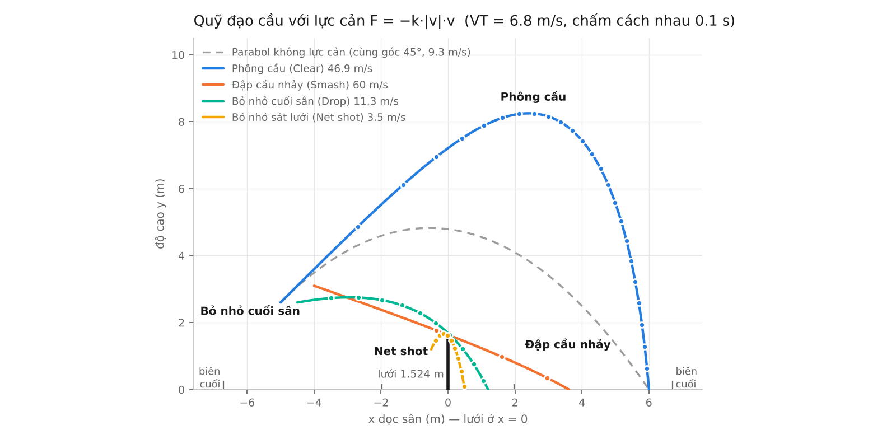

# GAME_SPEC.md — Đặc tả kỹ thuật game cầu lông 3D

> Mọi con số ở đây là **giá trị mặc định** và phải nằm trong `src/shared/config.ts`.
> Muốn đổi: sửa config, ghi lý do vào `docs/DECISIONS.md`, chạy lại toàn bộ test.
> Các số vật lý đã được kiểm chứng bằng `tools/shuttle_reference.py` (xem `tests/fixtures/shuttle_reference.json`).

---

## 1. Tổng quan

| Hạng mục | Mô tả |
|---|---|
| Thể loại | Thể thao, đánh đơn 1 đấu 1 |
| Nền tảng | Trình duyệt desktop (Chrome, Edge, Firefox, Safari mới). Mobile/touch là tùy chọn ở Phase 8 |
| Góc nhìn | 3D, camera nhìn ngang sân (side view). P1 bên trái (x < 0), P2 bên phải (x > 0) |
| Gameplay MVP | 2.5D: nhân vật chạy tới/lui theo trục X, nhảy; cầu bay trong mặt phẳng z = 0 |
| Chế độ | `pve` (đấu máy: Dễ / Thường / Khó), `local` (2 người 1 bàn phím), `online` (2 người qua mạng) |
| Luật | Tính điểm rally (ai thắng pha cầu được điểm và giao cầu tiếp). Mặc định ván 11 điểm, chơi 1 ván |

---

## 2. Hệ trục, đơn vị, kích thước sân

- Đơn vị SI. Trục **x dọc sân** (lưới ở x = 0), **y hướng lên** (sàn y = 0), **z ngang sân**.
- P1 đứng ở x < 0 và đánh về hướng +x (`facing = +1`). P2 đứng ở x > 0 (`facing = −1`).
- Kích thước tính đến **mép ngoài** của vạch. Vạch thuộc phần sân trong (cầu rơi trúng vạch là **IN**).

| Hằng số (`config.ts`) | Giá trị | Ghi chú |
|---|---|---|
| `COURT_HALF_LENGTH` | 6.70 m | sân dài 13.40 m |
| `COURT_HALF_WIDTH_DOUBLES` | 3.05 m | sân rộng 6.10 m (vẽ vạch, cột lưới) |
| `COURT_HALF_WIDTH_SINGLES` | 2.59 m | sân đơn rộng 5.18 m (dùng cho chế độ 3D ở Phase 8) |
| `SHORT_SERVICE_LINE` | 1.98 m | tính từ lưới |
| `DOUBLES_LONG_SERVICE_LINE` | 5.94 m | 0.76 m trước biên cuối (chỉ để vẽ) |
| `LINE_WIDTH` | 0.04 m | |
| `NET_HEIGHT_CENTER` | 1.524 m | dùng cho va chạm ở 2.5D |
| `NET_HEIGHT_POST` | 1.55 m | chiều cao cột lưới |
| `NET_DEPTH` | 0.76 m | chiều cao tấm lưới (mép dưới ở y ≈ 0.764) |
| `NET_TAPE_HEIGHT` | 0.075 m | băng trắng trên đỉnh lưới |

---

## 3. Vòng lặp và thời gian

- **Fixed timestep**: `PHYSICS_HZ = 120`, `DT = 1/120 s`. Mỗi tick nhân thêm `GAME_SPEED` (mặc định 1.0; cho phép 1.0 / 1.15 / 1.3 trong cài đặt).
  `GAME_SPEED` chỉ làm mọi thứ nhanh/chậm đều nhau, **hình dạng quỹ đạo không đổi** (test P2-U15).
- **Accumulator**: `acc += min(frameDelta, MAX_FRAME_DELTA)`, với `MAX_FRAME_DELTA = 0.1 s` (tối đa 12 tick/frame, tránh "spiral of death" khi tab bị treo).
  `while (acc >= DT) { sim.step(inputs); acc -= DT }`.
- **Nội suy khi render**: `alpha = acc / DT`. Vị trí vẽ = `lerp(prevState, currState, alpha)`.
- Khi tab bị ẩn (`visibilitychange`): tự động pause ở PvE/local. Online: không pause, chỉ ngừng render.
- Thời gian trong `src/shared` tính bằng **tick** (số nguyên). Đổi ra giây bằng `tick * DT * GAME_SPEED`.

---

## 4. Vật lý quả cầu (phần quan trọng nhất)

### 4.1 Mô hình lực

Lực cản không khí tỷ lệ với bình phương vận tốc, ngược hướng vận tốc:

```
F_drag = −k · |v| · v           (độ lớn k·v², hướng ngược v)
a      = g_vec − (k/m) · |v| · v
```

Tại vận tốc giới hạn `VT`, lực cản cân bằng trọng lực: `k/m = g / VT²`. Vì vậy **không cần khối lượng**, chỉ cần `VT`:

```
a = (0, −g, 0) − (g / VT²) · |v| · v
```

| Hằng số | Giá trị | Ghi chú |
|---|---|---|
| `GRAVITY` | 9.81 m/s² | |
| `SHUTTLE_TERMINAL_VELOCITY` (`VT`) | 6.8 m/s | cầu lông vũ thật khoảng 6.7–6.9 m/s |
| Độ dài đặc trưng `L = VT²/g` | 4.714 m | sau mỗi L mét bay "ngang", vận tốc giảm còn ~37% |
| `SHUTTLE_MAX_SPEED` | 120 m/s | chặn trên an toàn (chống NaN, cheat) |
| `SHUTTLE_MIN_SPEED_FOR_ORIENT` | 0.05 m/s | dưới mức này giữ hướng cũ |

Quả cầu được coi là **chất điểm** (tâm đế cầu). Kích thước chỉ dùng để vẽ.

### 4.2 Hệ quả phải nhìn thấy được (đã kiểm chứng bằng mô phỏng)



| Cú | Điểm chạm (x, y) | Vận tốc đầu | Góc | Kết quả mô phỏng |
|---|---|---|---|---|
| Clear cuối sân | (−5.0, 2.6) | 46.9 m/s | +45° | rơi x = 6.00, đỉnh (2.41, 8.25), bay 2.50 s, **góc rơi 85°**, vận tốc khi chạm sàn 6.7 m/s ≈ VT, tỷ lệ quãng xuống/quãng lên = 0.49 |
| Smash nhảy | (−4.0, 3.1) | 60 m/s | −19.5° | rơi x = 3.61 sau 0.36 s, qua lưới ở y = 1.63 với **chỉ còn 24.6 m/s** |
| Smash quá dốc | (−4.0, 2.7) | 55 m/s | −18.6° | qua x = 0 ở y = 1.30 < 1.524 → **chạm lưới** |
| Drop | (−4.5, 2.6) | 11.3 m/s | +10° | rơi x = 1.20 (trước vạch giao cầu ngắn), qua lưới cao 1.68 |
| Net shot | (−0.5, 1.2) | 3.46 m/s | +67.3° | rơi x = 0.50, qua lưới cao 1.60 (sát mép 8 cm) |
| Low serve | (−2.2, 1.05) | 9.16 m/s | +26.1° | rơi x = 2.30 (vừa qua vạch 1.98), qua lưới cao 1.62 |

Kiểm tra bằng mắt: quỹ đạo phải **lao nhanh rồi "khựng" lại và rơi gần như thẳng đứng**, khác hẳn parabol đối xứng.

### 4.3 Tích phân: RK4 bắt buộc

Lực cản tạo ra phương trình "cứng" ở vận tốc cao. Sai số đo được với smash 65 m/s:

| Bộ tích phân | 60 Hz | 120 Hz | 240 Hz |
|---|---|---|---|
| Semi-implicit Euler | sai điểm rơi **107 cm** | **52 cm** | 25 cm |
| RK4 | 0.05 cm | **0.01 cm** | ~0 |

→ Dùng **RK4 @120 Hz**. Pseudo-code (chỉ dùng `+ - * /` và `Math.sqrt`):

```ts
function accel(v: Vec3, out: Vec3, c: PhysicsConfig): Vec3 {
  const sp = Math.sqrt(v.x*v.x + v.y*v.y + v.z*v.z);
  const k = c.dragEnabled ? (c.g / (c.vt * c.vt)) * sp : 0;
  out.x = -k * v.x;
  out.y = (c.gravityEnabled ? -c.g : 0) - k * v.y;
  out.z = -k * v.z;
  return out;
}
// stepShuttle(state, dt): RK4 chuẩn cho cặp (p, v); k1..k4 của p chính là v tại các điểm giữa.
// Dùng scratch vector tái sử dụng, không cấp phát.
```

### 4.4 Va chạm

Mỗi tick lấy đoạn `p_prev → p_new` để kiểm tra (**swept test**, vì smash 65 m/s đi 0.54 m mỗi tick).

**Sàn**
- Phát hiện khi `p_new.y ≤ 0` và `v.y < 0`. Nội suy tuyến tính tìm điểm chạm `f = p_prev.y / (p_prev.y − p_new.y)`.
- Phát sự kiện `land { x, z, tick, subTickFraction }` **đúng một lần**, sau đó `shuttle.state = 'grounded'`, đứng yên.

**Lưới** (2.5D: mặt phẳng x = 0, từ y = 0 đến `NET_HEIGHT_CENTER`; 3D: thêm điều kiện |z| ≤ 3.05)
- Nếu đoạn `p_prev → p_new` cắt x = 0 và độ cao tại điểm cắt `< NET_HEIGHT_CENTER` → va chạm lưới.
- Phản hồi: đặt x = `−sign(v.x) · 0.02`, `v.x = −0.15 · v.x`, `v.y = min(v.y, 0) · 0.5`, `v.z *= 0.3`. Phát sự kiện `netHit`.
  Sau đó cầu rơi xuống sàn bên phía người vừa đánh.
- `NET_CORD_ENABLED = false` ở MVP. (Tùy chọn sau: nếu chạm trong 3 cm sát mép trên, 50% cơ hội lăn qua lưới, dùng RNG có seed.)
- Không có trần nhà, không có tường. Cầu bay ra ngoài sân thì vẫn rơi xuống sàn và bị xử OUT.

### 4.5 Hướng đầu cầu (nút bần luôn bay trước)

- Hướng mũi `nose = normalize(v)` khi `|v| ≥ SHUTTLE_MIN_SPEED_FOR_ORIENT`, ngược lại giữ hướng cũ.
- Làm mượt bằng slerp: `q = slerp(q, target, 1 − exp(−ORIENT_RATE·dt))`, `ORIENT_RATE = 40 /s` (hằng số thời gian 0.025 s).
  Sau cú đánh, vận tốc đổi chiều nên cầu sẽ **lật 180° rất nhanh**, giống cú "turnover" của cầu thật.
  Trường hợp hai hướng ngược nhau đúng 180°: slerp không xác định trục quay, phải chọn một trục vuông góc (ví dụ trục z).
- Hàm thuần `shuttleOrientation(prevQ, v, dt) → q` đặt trong `src/shared/physics/orientation.ts` (không dùng Three).
  Phần exp ở đây chỉ phục vụ hiển thị, không ảnh hưởng mô phỏng nên được phép.
- Mesh: nút bần nằm ở trục **+Y cục bộ**. Client dùng `quaternion.setFromUnitVectors((0,1,0), nose)` rồi slerp.

### 4.6 API vật lý (`src/shared/physics`)

```ts
stepShuttle(s: ShuttleState, dt: number, cfg: PhysicsConfig, scratch: Scratch): StepResult // RK4 + va chạm
simulateFlight(p0: Vec3, v0: Vec3, opts: { collideNet: boolean; maxTime?: number; dt?: number }): FlightResult
//  FlightResult = { landed, tLand, land: {x,z}, apex: {x,y}, netCross: {y, speed} | null, hitsNet, path?: Vec3[] }
predictUntil(s: ShuttleState, predicate: (p, v, t) => boolean, maxTime: number): { t, p, v } | null
```

`simulateFlight` dùng chính `stepShuttle` (cùng dt), nên AI dự đoán **khớp tuyệt đối** với thực tế khi nhiễu = 0.

---

## 5. Hệ thống cú đánh

### 5.1 Vung vợt (swing state machine)

```
READY --(nhấn nút đánh)--> WINDUP (0.05 s) --> ACTIVE (0.20 s, hitbox bật) --> RECOVERY (0.25 s) --> READY
```

| Hằng số | Giá trị |
|---|---|
| `SWING_WINDUP` | 0.05 s |
| `SWING_ACTIVE` | 0.20 s (đúng yêu cầu "hitbox bật 0.2 giây") |
| `SWING_RECOVERY` | 0.25 s |
| `SWING_MOVE_FACTOR` | 0.5 (tốc độ chạy khi đang vung) |

- Nhấn nút khi không ở `READY` thì **bỏ qua** (không xếp hàng lệnh).
- Mỗi lần vung đánh trúng **tối đa 1 lần**.
- Sau khi P đánh trúng, P không thể đánh tiếp cho đến khi đối thủ chạm cầu hoặc pha cầu kết thúc (chống chạm 2 lần).

### 5.2 Kiểu vung và hitbox

Khi bắt đầu vung, dự đoán vị trí cầu tại `t + SWING_WINDUP + SWING_ACTIVE/2` (= +0.15 s) bằng `predictUntil`.
Độ cao dự đoán so với chân nhân vật quyết định kiểu vung:

| Kiểu vung | Điều kiện (độ cao dự đoán) | Tâm hitbox (so với chân, `f` = facing) | Bán kính |
|---|---|---|---|
| `overhead` | ≥ 1.8 m | (f·0.20, 2.30 + độ cao nhảy, 0) | 0.50 m |
| `mid` | 1.0 – 1.8 m | (f·0.45, 1.40, 0) | 0.50 m |
| `underhand` | < 1.0 m | (f·0.50, 0.60, 0) | 0.55 m |
| `serve` | đang giao cầu | tự động chạm cầu đang cầm ở (f·0.35, 1.00, 0) | — |

- Phát hiện va chạm: khoảng cách từ **đoạn** `p_prev → p_new` của cầu đến tâm hitbox `≤ bán kính` (swept sphere).
- **Chỉ đánh được cầu ở phía sân mình**: `shuttle.x · facing ≤ 0`.
- Thời điểm chạm (`contactTime` trong cửa sổ ACTIVE) dùng để chấm timing (§5.5).

### 5.3 Phím đánh và phân loại cú đánh

3 nút đánh: **High** (cao/sâu), **Power** (mạnh), **Soft** (nhẹ). Loại cú = nút × kiểu vung × ngữ cảnh:

| Kiểu vung | High | Power | Soft |
|---|---|---|---|
| `overhead` | `CLEAR` | `SMASH` nếu độ cao điểm chạm ≥ `SMASH_MIN_CONTACT_Y` (2.2 m), ngược lại `DRIVE` | `DROP` |
| `mid` | `LIFT` | `DRIVE` | `BLOCK` |
| `underhand` | `LIFT` | `DRIVE` (solver tự nâng góc để qua lưới) | `NET_SHOT` nếu \|x người đánh\| ≤ 2.5 m, ngược lại `BLOCK` |
| `serve` | `HIGH_SERVE` | `HIGH_SERVE` | `LOW_SERVE` |

**Smash** chỉ có khi đánh trên cao (đứng ở điểm cao, hoặc đang nhảy). Đang nhảy thì tốc độ smash × `JUMP_SMASH_SPEED_MULT = 1.08` và góc cắm dốc hơn nhờ điểm chạm cao.

### 5.4 Bảng thông số từng cú (mặc định)

Ba chế độ giải (`solveMode`):
- `FIXED_ELEV`: cố định góc bắn, tìm tốc độ sao cho cầu rơi đúng điểm đích.
- `FIXED_SPEED`: cố định tốc độ, tìm góc (dùng cho smash).
- `TWO_POINT`: tìm cả góc lẫn tốc độ sao cho cầu **qua lưới ở độ cao `NET + clearance`** và **rơi đúng điểm đích**.

Điểm đích tính theo khoảng cách từ lưới về phía đối thủ (`targetDepth`), đổi sang tọa độ: `x = facing · targetDepth`.

| Cú | Solve mode | Tham số | Đích mặc định (m từ lưới) | Tham chiếu mô phỏng |
|---|---|---|---|---|
| `CLEAR` | FIXED_ELEV | góc 45° | 6.0 (khoảng 5.6–6.4) | từ (−5.0, 2.6): 46.9 m/s; từ (−3.5, 2.6): 31.4 m/s |
| `LIFT` | FIXED_ELEV | góc 55° | 6.0 | từ (−1.5, 0.6): 27.0 m/s, đỉnh 5.5 m |
| `SMASH` | FIXED_SPEED | 60 m/s (nhảy 65 m/s) | 4.5 (khoảng 3.0–5.5) | từ (−4.0, 2.7): đích gần nhất còn qua lưới ≥ 10 cm là **4.4 m** (góc −14.4°); từ (−4.0, 3.1): **3.6 m** (−19.5°); từ (−2.0, 3.0): **2.3 m** (−34°) |
| `DRIVE` | FIXED_ELEV | góc 3° (tự nâng nếu vướng lưới) | 5.0 | từ (−3.0, 1.5): 30.3 m/s → rơi 5.5 m |
| `DROP` | FIXED_ELEV | góc 10° | 1.4 (khoảng 0.8–1.9) | từ (−4.5, 2.6) → 1.2 m: 11.3 m/s |
| `BLOCK` | TWO_POINT | clearance 0.20 m | 1.5 | từ (−3.0, 0.8): góc 37.8°, 9.37 m/s |
| `NET_SHOT` | TWO_POINT | clearance 0.08 m | 0.5 | từ (−0.5, 1.2): góc 67.3°, 3.46 m/s |
| `HIGH_SERVE` | FIXED_ELEV | góc 55° | 6.3 | từ (−2.2, 1.0): 36.3 m/s |
| `LOW_SERVE` | TWO_POINT | clearance 0.10 m | 2.3 | từ (−2.2, 1.05): góc 26.1°, 9.16 m/s |

### 5.5 Shot solver (`src/shared/shots/shotSolver.ts`)

```ts
solveShot(req: {
  shot: ShotType; contact: Vec3; facing: 1 | -1; targetDepth: number;
  params: ShotParams; assist: boolean;
}): { v0: Vec3; speed: number; elevationDeg: number; flight: FlightResult; adjusted: boolean }
```

- Dùng **bisection** trên `simulateFlight` với `collideNet: false`, **dừng sớm** khi sai số điểm rơi < 2 mm (thường 15–20 vòng):
  - FIXED_ELEV: tìm tốc độ trong [1, 150] m/s (điểm rơi tăng đơn điệu theo tốc độ).
  - FIXED_SPEED: tìm góc trong [−60°, +10°] (điểm rơi tăng đơn điệu theo góc).
  - TWO_POINT: vòng ngoài tìm góc trong [−30°, 85°] (dừng khi lệch độ cao qua lưới < 2 mm), vòng trong tìm tốc độ trong [0.5, 40] m/s cho điểm rơi. Độ cao qua lưới tăng đơn điệu theo góc. Nếu cầu không bay tới lưới thì coi như "qua lưới quá thấp".
- **Kiểm tra lưới khi `assist = true`**: yêu cầu `netCross.y ≥ NET_HEIGHT_CENTER + MIN_NET_CLEARANCE` (0.10 m cho smash/drive, 0.05 m cho các cú khác). Nếu không đạt:
  - FIXED_ELEV: tăng góc 2° mỗi lần, tối đa +20°.
  - FIXED_SPEED: đẩy đích sâu thêm 0.1 m mỗi lần, tối đa `COURT_HALF_LENGTH − 0.3`.
  - Đánh dấu `adjusted = true`.
- Hiệu năng (trung vị): FIXED_ELEV / FIXED_SPEED < 3 ms, TWO_POINT < 6 ms. Có test đo (P3-U20). Nếu chậm hơn: thu hẹp khoảng tìm, dùng nghiệm lần trước làm điểm xuất phát.
- Chỉ chạy ở phía **có thẩm quyền** (local sim hoặc server). Client online nhận `v0` từ sự kiện `hit`.

### 5.6 Timing và sai số

Độ lệch `δ = |contactTime − SWING_ACTIVE/2|` (tâm cửa sổ ACTIVE là 0.10 s):

| Timing | δ | σ đích (m) | σ góc (°) | σ clearance (m) | Hệ số tốc độ |
|---|---|---|---|---|---|
| `PERFECT` | ≤ 0.035 s | 0 | 0 | 0 | 1.05 (chỉ smash/drive) |
| `GOOD` | ≤ 0.070 s | 0.25 | 1.0 | 0.03 | 1.00 |
| `OK` (sớm/muộn) | > 0.070 s | 0.60 | 3.0 | 0.08 | 0.90 |

- Quy trình: (1) giải cú đánh lý tưởng với `assist = true`; (2) cộng nhiễu vào đích/góc/clearance; (3) giải lại với `assist = false`.
  Vì vậy timing kém **có thể** làm cầu ra ngoài hoặc chạm lưới. Đó là lỗi của người chơi.
- Phân phối chuẩn xấp xỉ bằng Irwin–Hall: `gauss = (u1 + u2 + u3 + u4 − 2) · √3` với `u` từ RNG có seed (không cần log/cos).
- Popup trên HUD: "PERFECT!" / "GOOD" / "SỚM" / "MUỘN".

### 5.7 Điều hướng cú đánh (aim)

`aim` lấy từ hướng phím di chuyển lúc nhấn nút đánh: giữ **về phía lưới** = `+1` (đánh ngắn hơn), giữ **về phía sau** = `−1` (đánh sâu hơn).

| Nhóm cú | Thay đổi đích theo aim |
|---|---|
| CLEAR, LIFT, HIGH_SERVE | ∓ 0.6 m |
| SMASH, DRIVE | ∓ 0.8 m |
| DROP, BLOCK, NET_SHOT, LOW_SERVE | ∓ 0.3 m |

Đích sau khi aim được kẹp trong sân, cách biên ít nhất 0.2 m (trước khi cộng nhiễu timing).

### 5.8 Sự kiện `hit`

```ts
{ type: 'hit', tick, hitter: 0 | 1, shot: ShotType, swing: SwingKind, timing: 'PERFECT' | 'GOOD' | 'OK',
  contact: Vec3, v0: Vec3, speedKmh: number, targetDepth: number, adjusted: boolean }
```

---

## 6. Nhân vật

### 6.1 Di chuyển

| Hằng số | Giá trị | Hệ quả (dùng trong test) |
|---|---|---|
| `PLAYER_MAX_SPEED` | 5.0 m/s | |
| `PLAYER_ACCEL` | 30 m/s² | đạt tốc độ tối đa sau 0.167 s |
| `PLAYER_DECEL` | 40 m/s² | thả phím ở 5 m/s → dừng sau 0.3125 m |
| `PLAYER_AIR_CONTROL` | 0.5 | hệ số gia tốc khi đang ở trên không |
| `JUMP_V0` | 4.2 m/s | |
| `PLAYER_GRAVITY` | 16 m/s² | đỉnh nhảy v0²/2g = 0.551 m, thời gian bay 2v0/g = 0.525 s |
| `PLAYER_NET_MARGIN` | 0.35 m | không bước gần lưới hơn mức này |
| `PLAYER_BACK_LIMIT` | 8.0 m | được lùi ra ngoài biên cuối tối đa 1.3 m |
| `PLAYER_HEIGHT` | 1.75 m | chỉ để vẽ |
| `PLAYER_BODY_HALF_WIDTH` | 0.25 m | |

- Trục dọc dùng công thức chính xác cho gia tốc không đổi: `y += vy·dt − ½·g·dt²`, `vy −= g·dt` (để đỉnh nhảy khớp test P1-U04).
- Không nhảy kép. Không nhảy khi đang giao cầu.
- Phím đối nhau cùng lúc → `moveX = 0`. Cửa sổ mất focus (`blur`) → thả hết phím (chống kẹt phím).
- Sự kiện `squeak` (tiếng giày): khi `|vx| > 3 m/s` và gia tốc ngược chiều vận tốc, tối đa 1 lần mỗi 0.35 s.

### 6.2 Điều khiển

| Hành động | P1 (PvE, online, local trái) | P2 (local phải) |
|---|---|---|
| Chạy tới / lui | `A` / `D` | `←` / `→` |
| Nhảy | `W` | `↑` |
| Đánh High (phông, lốp, giao cao) | `J` | `Numpad 1` hoặc `,` |
| Đánh Power (đập, tạt) | `K` | `Numpad 2` hoặc `.` |
| Đánh Soft (bỏ nhỏ, chặn, giao thấp) | `L` | `Numpad 3` hoặc `/` |
| Tạm dừng | `Esc` | `Esc` |
| Debug overlay | `F3` | |

Phím lưu dưới dạng `KeyboardEvent.code` (không phụ thuộc bố cục bàn phím, gõ tiếng Việt Telex không ảnh hưởng).

### 6.3 Trạng thái animation

`idle` (thở), `run_forward`, `run_back`, `jump`, `swing_overhead`, `swing_mid`, `swing_underhand`, `serve`, `lunge` (tùy chọn), `celebrate`, `disappointed`.
Ánh xạ từ state mô phỏng sang animation là hàm thuần (test P6-U01). Crossfade 0.1 s.
**Khung hình vợt chạm cầu của animation vung phải trùng tâm cửa sổ ACTIVE** (test P6-U02).

---

## 7. Luật và tính điểm

### 7.1 Cấu hình điểm

| Preset | Điểm thắng | Hơn tối thiểu | Điểm trần (ai chạm trước thắng) |
|---|---|---|---|
| Nhanh | 5 | 2 | 7 |
| Mặc định | 11 | 2 | 15 |
| Chuẩn BWF | 21 | 2 | 30 |

`gamesToWin`: 1 (chơi 1 ván) hoặc 2 (thắng 2 trong 3 ván). Người giao đầu tiên: bốc thăm bằng RNG có seed.
Tính điểm rally: thắng pha cầu được +1 và giao cầu tiếp.

### 7.2 Phân xử pha cầu (`rallyJudge.ts`)

```
Khi cầu chạm sàn tại x:
  owner     = x < 0 ? P1 : P2
  inBounds  = |x| ≤ COURT_HALF_LENGTH        (3D: thêm |z| ≤ COURT_HALF_WIDTH_SINGLES)

  Nếu đây là quả giao và người nhận chưa chạm cầu:
     nếu owner == người giao          → người giao thua (reason = netHit ? NET : SERVE_FAULT)
     nếu |x| < SHORT_SERVICE_LINE     → người giao thua (SERVE_SHORT)
     nếu |x| > COURT_HALF_LENGTH      → người giao thua (OUT)
     ngược lại                        → người nhận thua (IN)
  Ngược lại:
     nếu inBounds → owner thua (reason = netHit && owner == người vừa đánh ? NET : IN)
     nếu out      → người vừa đánh thua (OUT)
```

Lỗi kết thúc pha cầu ngay lập tức (không chờ cầu rơi):

| Mã | Khi nào | Người thua |
|---|---|---|
| `SERVE_TOO_HIGH` | điểm chạm khi giao `y > SERVE_MAX_CONTACT_Y` (1.15 m, luật BWF hiện hành thay cho "dưới thắt lưng") | người giao |
| `DOUBLE_HIT` | một người chạm cầu 2 lần liên tiếp (lẽ ra đã bị chặn, đây là lưới an toàn) | người đó |
| `REACH_OVER` | chạm cầu khi cầu ở phía sân đối phương | người đó |

Thông báo HUD: `IN` → "ĐIỂM!", `OUT` → "CẦU RA NGOÀI", `NET` → "CHẠM LƯỚI", `SERVE_SHORT` → "GIAO CẦU NGẮN",
`SERVE_FAULT` → "LỖI GIAO CẦU", `SERVE_TOO_HIGH` → "GIAO CẦU QUÁ CAO", `DOUBLE_HIT` → "CHẠM CẦU 2 LẦN", `REACH_OVER` → "ĐÁNH QUA LƯỚI".

### 7.3 Giao cầu

- **Vị trí** (2.5D): người giao đứng ở `x = ∓2.6` (0.6 m sau vạch giao cầu ngắn), người nhận ở `x = ±3.0`.
  Người giao được di chuyển trong vùng `1.98 ≤ |x| ≤ 6.7` phía mình nhưng không được nhảy.
- Cầu nằm ở tay người giao tại (f·0.35, 1.00). Nhấn **High** → `HIGH_SERVE`, **Soft** → `LOW_SERVE`.
  Có `SERVE_WINDUP = 0.15 s`, chạm cầu tự động ở độ cao 1.00 m (hợp lệ).
- Ô giao cầu hợp lệ (2.5D): phía đối phương, `1.98 ≤ |x| ≤ 6.7`.
- **Chế độ 3D (Phase 8)**: điểm người giao chẵn → giao từ ô phải, lẻ → ô trái, cầu phải rơi vào ô chéo.
  Hàm `serviceCourt(score)` viết và test sẵn từ Phase 4 (P4-U10).
- Máy giao sau `0.8–1.5 s` ngẫu nhiên. Người chơi không giới hạn thời gian ở MVP.

### 7.4 Máy trạng thái trận đấu (`stateMachine.ts`)

```
MENU → MATCH_INTRO (1.5 s) → SERVE_SETUP (0.8 s, nhân vật về vị trí giao)
     → AWAIT_SERVE → RALLY → POINT_END (1.5 s)
     → [ván chưa xong] SERVE_SETUP
     → [ván xong] GAME_END (3 s) → [trận chưa xong] SERVE_SETUP | [trận xong] MATCH_END
PAUSED: vào/ra từ MATCH_INTRO..GAME_END (không có ở online, trừ khi đối thủ mất kết nối)
MATCH_END → MENU | (Chơi lại) MATCH_INTRO
```

Chuyển trạng thái không hợp lệ bị từ chối và log cảnh báo (test P4-U11). Bất biến: tổng điểm hai bên = số pha cầu đã kết thúc trong ván.

---

## 8. AI (`src/shared/ai`)

### 8.1 Nguyên tắc

- Bot chỉ xuất ra `InputFrame`, đi qua đúng đường mô phỏng như người chơi.
- Bot chỉ dùng thông tin người chơi nhìn thấy được: vị trí và vận tốc cầu, vị trí đối thủ, tỷ số.
- Mọi ngẫu nhiên đi qua RNG có seed để test tất định.

### 8.2 Vòng quyết định

```
Khi đối thủ đánh (sự kiện hit):
  chờ reactionMs  →  PLAN #1: dự đoán điểm đánh (có nhiễu predictNoise)
Khi cầu qua lưới:  PLAN #2: dự đoán lại với nhiễu × 0.4
Mỗi tick:          di chuyển tới điểm đứng, nhảy và vung đúng lúc
Sau khi đánh:      chạy về vị trí cơ sở x = ±3.4
```

**Dự đoán** (`predictor.ts`): dùng `predictUntil` tìm lần đầu cầu đang rơi đi qua độ cao tâm hitbox `overhead` (2.3 m, hoặc 2.85 m nếu nhảy), `mid` (1.4 m), `underhand` (0.6 m) ở phía sân bot, cùng điểm rơi cuối cùng. Mỗi ứng viên có `{ kind, t, x }`.

**Chọn ứng viên**: điểm đứng = `x − facing · offsetX(kind)` (để cầu đi qua tâm hitbox). Ứng viên khả thi nếu
`thời gian chạy (có tính 0.17 s tăng tốc) + thời gian phản xạ còn lại ≤ t − 0.15 s`.
Ưu tiên `overhead` (tấn công), rồi `mid`, rồi `underhand`. Bot Dễ ưu tiên ứng viên muộn nhất (an toàn).

**Bỏ cầu ra ngoài**: nếu điểm rơi dự đoán nằm ngoài sân hơn `leaveMarginM`, bot không vung và tránh ra.

**Di chuyển**: `moveX = clamp((standX − x) / 0.25, −1, 1)` với vùng chết 0.05 m (chống rung lắc).
**Nhảy smash**: nhảy tại `t_contact − JUMP_V0 / PLAYER_GRAVITY` (= 0.2625 s) để chạm cầu ở đỉnh nhảy.
**Vung**: nhấn nút tại `t_contact − (SWING_WINDUP + SWING_ACTIVE/2) + N(0, timingSigma)`.

### 8.3 Chọn cú đánh

Trọng số cơ bản (nhân `smashWeightMult` cho SMASH, sau đó chuẩn hóa). SMASH chỉ được chọn khi điểm chạm dự kiến ≥ 2.2 m.

| Tình huống | Trọng số |
|---|---|
| overhead, cách lưới > 4.5 m | CLEAR 0.50, DROP 0.35, SMASH 0.15 |
| overhead, 2.5–4.5 m | SMASH 0.45, DROP 0.30, CLEAR 0.25 |
| overhead, < 2.5 m | SMASH 0.70, DROP 0.20, CLEAR 0.10 |
| mid | DRIVE 0.50, LIFT 0.30, BLOCK 0.20 |
| underhand, \|x\| ≤ 2.5 m | NET_SHOT 0.50, LIFT 0.50 |
| underhand, \|x\| > 2.5 m | LIFT 0.75, BLOCK 0.25 |

**Đặt đích** (`aimSmart`): với xác suất `aimSmart`, chọn aim làm cầu xa đối thủ nhất
(đối thủ đứng gần lưới → đánh sâu, đứng sâu → đánh ngắn). Còn lại aim ngẫu nhiên.

### 8.4 Độ khó

| Tham số | Dễ | Thường | Khó |
|---|---|---|---|
| `reactionMs` | 380 | 240 | 140 |
| `predictNoiseM` (σ, plan #1) | 0.70 | 0.35 | 0.12 |
| `speedFactor` (× tốc độ tối đa) | 0.80 | 0.92 | 1.00 |
| `timingSigmaS` | 0.055 | 0.035 | 0.018 |
| `leaveMarginM` | không bao giờ bỏ | 0.50 | 0.15 |
| `smashWeightMult` | 0.5 | 1.0 | 1.4 |
| `aimSmart` | 0.30 | 0.60 | 0.85 |
| `jumpSmashChance` | 0 | 0.30 | 0.60 |

Mục tiêu cân bằng: người mới thắng được bot Dễ; bot Khó thắng bot Dễ ≥ 80% số ván 5 điểm (test P5-U09).

---

## 9. PvP online (Phase 7)

### 9.1 Kiến trúc

- **Server-authoritative**: server chạy `MatchSim` (cùng code `src/shared`) và là nguồn sự thật duy nhất cho vị trí, va chạm, điểm số.
- Server: Node + Colyseus. Room `match`, tối đa 2 client. Vòng lặp 60 Hz, mỗi vòng 2 bước con (= 120 Hz).
- Dùng **Schema state** của Colyseus cho dữ liệu meta (người chơi, ready, kết nối, phase, tỷ số, mã phòng).
  Dữ liệu tần số cao gửi bằng **message** (`input`, `snap`, `ev`).
- Interface `NetTransport` (connect, send, onMessage, close) để thay Colyseus bằng Socket.io hoặc bằng transport giả trong test.

### 9.2 Giao thức (`src/shared/net/protocol.ts`)

| Hướng | Message | Nội dung | Tần suất |
|---|---|---|---|
| C → S | `input` | `{ s: seq, mx, j, sw, a }` | mỗi tick client (60 Hz) |
| C → S | `ready`, `rematch` | `{}` | khi bấm |
| C → S | `ping` | `{ c: clientTimeMs }` | mỗi 2 s |
| S → C | `snap` | `{ t: tick, ack: [seq0, seq1], p: [[x,y,vx,vy,state,swingT], ...], sh: [x,y,z,vx,vy,vz,state] }` | 30 Hz |
| S → C | `ev` | `{ t: tick, events: SimEvent[] }` (hit, netHit, land, rallyEnd, score...) | ngay khi có |
| S → C | `pong` | `{ c, s: serverTick }` | trả lời ping |

**Kiểm tra dữ liệu** (`validate.ts`): `mx` hữu hạn, kẹp [−1, 1]; `j` boolean; `sw` thuộc enum hoặc null; `a` ∈ {−1, 0, 1};
`s` số nguyên tăng dần (bỏ gói cũ); message > 256 byte bị bỏ; quá 120 input/giây thì bỏ phần dư. Message lạ bị bỏ qua.
Client **không có** message nào để gửi vị trí, điểm số hay va chạm.

### 9.3 Đồng bộ phía client

- **Người chơi của mình**: client-side prediction (chạy `playerSim` với input ngay lập tức).
  Khi có `snap`: lấy state server tại `ack`, áp dụng lại các input chưa được xác nhận (reconciliation).
  Sai lệch < 0.3 m thì làm mượt trong 100 ms, lớn hơn thì nhảy thẳng tới vị trí đúng.
- **Đối thủ**: nội suy với độ trễ 100 ms (khoảng 3 snapshot). Không ngoại suy quá 250 ms.
- **Quả cầu**: khi nhận `hit` (có `v0` và tick), client tự mô phỏng tiếp bằng `stepShuttle`, tua nhanh tới tick server ước tính
  (`lastSnapTick + thời gian từ lúc nhận × 120 + RTT/2 × 120`). Vì vật lý tất định nên cầu bay mượt mà không cần nhiều băng thông.
  So với `snap`: lệch > 5 cm thì kéo dần về trong 100 ms, lệch > 1 m thì nhảy thẳng.
- **Va chạm vợt–cầu do server quyết định**. Animation vung chạy ngay ở client. Âm thanh và hiệu ứng chạm cầu phát khi nhận `ev.hit`.
  Mở rộng (Phase 7b, tùy chọn): lag compensation, server tua lại vị trí cầu tối đa 150 ms khi xét hitbox của người có độ trễ cao.

### 9.4 Phòng chơi

- **Tạo phòng**: server sinh mã 5 ký tự từ bảng `ABCDEFGHJKLMNPQRSTUVWXYZ23456789` (bỏ 0/O/1/I), lưu `Map<code, roomId>`.
  `GET /api/code/:code` trả về `roomId`, client gọi `joinById`. (Kiểm tra lại API thật của bản Colyseus đã cài.)
- **Ghép ngẫu nhiên**: `joinOrCreate('match', { mode: 'quick' })`, phòng private không tham gia ghép.
- **Bắt đầu**: cả 2 bấm sẵn sàng → `MATCH_INTRO`. Phòng đủ 2 người thì người thứ 3 bị từ chối với lỗi `ROOM_FULL`.
- **Mất kết nối**: room chuyển `PAUSED`, giữ chỗ 20 s (`allowReconnection`). Quay lại kịp thì tiếp tục đúng tỷ số. Quá hạn thì người còn lại thắng do đối thủ bỏ cuộc.
- **Ping** hiển thị góc màn hình. Ping > 200 ms thì hiện cảnh báo màu vàng.
- **Hook test phía server**: chỉ khi `NODE_ENV=test`, nhận message `debug:forceLanding { x }`. Không tồn tại trong bản production.

### 9.5 Triển khai

- Client: build tĩnh (Vite) lên host tĩnh bất kỳ. `VITE_SERVER_URL` trỏ tới server.
- Server: Node trên host hỗ trợ WebSocket. Cấu hình CORS/origin theo domain client. Có endpoint `/health`.

---

## 10. Đồ họa và camera

### 10.1 Renderer
`antialias: true`, `setPixelRatio(min(devicePixelRatio, 2))`, bóng đổ `PCFSoftShadowMap`, tone mapping ACES, color space sRGB.
Ánh sáng: 1 hemisphere + 1 directional có bóng (shadow map 2048, chỉ bao vùng sân).

### 10.2 Sân và lưới
- Sàn ngoài 20 × 12 m màu tối hoặc vân gỗ. Thảm sân màu xanh lá. Vạch trắng 4 cm vẽ bằng `CanvasTexture` độ phân giải cao (anisotropy tối đa).
- Lưới: tấm phẳng rộng 6.10 m, cao 0.76 m, mép trên ở 1.524 m, texture lưới có alpha, băng trắng 7.5 cm trên đỉnh. 2 cột ở z = ±3.05, cao 1.55 m.

### 10.3 Quả cầu (nhìn thấy được là ưu tiên số 1)
- Mesh: nút bần là nửa khối cầu bán kính 0.013 m màu trắng ngà. Váy lông là hình nón cụt mở (bán kính 0.013 → 0.032 m, dài 0.065 m, 16 cạnh), trắng bán trong suốt, có vân lông vũ.
- `SHUTTLE_VISUAL_SCALE = 2.5`. Cầu thật quá nhỏ khi nhìn từ camera cách 15 m, nên phóng to khi vẽ (chỉ ảnh hưởng hiển thị, không ảnh hưởng vật lý).
- **Bóng tròn dưới cầu** (blob shadow) luôn hiện, mờ dần theo độ cao. Rất quan trọng để đoán điểm rơi trong 3D.
- **Vệt bay (trail)**: 0.3 s gần nhất, mờ dần. Ở `?debug=1` vẽ thêm chấm mỗi 0.1 s (thấy rõ cầu giảm tốc).
- Cầu bay lên trên khung hình: hiện mũi tên chỉ báo ở mép trên màn hình.

### 10.4 Nhân vật
- Phase 1–5: hộp chữ nhật 0.5 × 1.75 × 0.4 m (P1 xanh dương `#257de0`, P2 cam `#f47230`) và một khối nhỏ biểu thị vợt.
- Phase 6: **người que 3D** dựng từ capsule và sphere (đầu, thân, 2 tay 2 khớp, 2 chân 2 khớp) cầm vợt
  (cán 0.30 m, khung elip 0.23 × 0.29 m, mặt lưới bán trong suốt). Animation bằng keyframe xoay khớp.
  Tùy chọn: model GLTF CC0 có sẵn animation, dùng `AnimationMixer`.

### 10.5 Camera
- `PerspectiveCamera` fov 40°, vị trí (0, 3.2, 15.5), nhìn vào (0, 2.2, 0).
- Động: điểm nhìn theo độ cao cầu `lookY = clamp(lerp(2.2, shuttle.y · 0.6), 2.2, 4.5)`; khi cầu cao hơn 6 m thì lùi camera tới z = 18. Mọi chuyển động làm mượt (damping).
- Màn hình hẹp (dọc): tăng khoảng cách sao cho thấy đủ x ∈ [−7.6, 7.6].

### 10.6 Hiệu ứng
- Tia lửa nhỏ khi chạm cầu (0.15 s). Smash: vệt trắng + rung camera 0.08 s, biên độ 0.05 m. Cầu chạm sàn: bụi nhỏ + vòng tròn đánh dấu điểm rơi (đỏ = OUT, xanh = IN).
- Popup chữ: tên cú + tốc độ ("SMASH 234 km/h"), timing ("PERFECT!").
- Tùy chọn: slow-motion 0.5× trong 1 s ở điểm quyết định ván.

---

## 11. Giao diện (DOM overlay, tiếng Việt)

- **Menu chính**: Chơi với máy (chọn Dễ / Thường / Khó) · 2 người 1 máy · Chơi online (Tạo phòng · Nhập mã phòng · Ghép ngẫu nhiên) · Cài đặt · Hướng dẫn.
- **Cài đặt**: điểm mỗi ván (5 / 11 / 21), số ván (1 / 3), tốc độ game (1.0 / 1.15 / 1.3), âm lượng tổng và hiệu ứng, bật/tắt bóng đổ, bật debug.
  Lưu vào `localStorage` (bọc try/catch, lỗi thì dùng mặc định).
- **HUD**: tên hai bên, điểm, số ván thắng, biểu tượng người đang giao, popup lý do kết thúc pha cầu, popup cú đánh. Online: ping.
- **Tạm dừng**: Tiếp tục · Chơi lại · Về menu.
- **Kết quả**: Thắng/Thua, thống kê (số smash, smash nhanh nhất km/h, pha cầu dài nhất, tỷ lệ PERFECT), nút Chơi lại / Về menu.
- **Hướng dẫn**: bảng phím (§6.2) và mô tả các cú đánh.
- Mọi chuỗi nằm trong `src/client/ui/i18n/vi.ts`. Phần tử UI quan trọng có `data-testid` cho Playwright.

---

## 12. Âm thanh

- `AudioManager` dùng Web Audio API. Chỉ tạo/mở `AudioContext` sau thao tác đầu tiên của người dùng (chính sách autoplay).
  Không có `AudioContext` (môi trường test) thì chạy chế độ im lặng, không ném lỗi.
- Pan stereo theo vị trí x (`StereoPannerNode`, x = ±6.7 ↔ pan ±0.6).
- **SFX tổng hợp mặc định** (`synth.ts`). Có thể thay bằng file CC0 trong `public/audio/` cùng tên.

| SFX | Kích hoạt | Công thức tổng hợp gợi ý |
|---|---|---|
| `swing` | bắt đầu ACTIVE | noise qua bandpass quét 400 → 2500 Hz, 120 ms. Âm lượng theo nút (Power to nhất) |
| `hit_smash` | hit SMASH | noise highpass 2 kHz, 25 ms + sine 1.8 kHz tắt nhanh 40 ms + chút distortion. Tiếng "chát" đanh |
| `hit_normal` | hit CLEAR / LIFT / DRIVE / HIGH_SERVE | noise bandpass 1.2 kHz, 35 ms + sine 900 Hz, 50 ms |
| `hit_soft` | hit DROP / NET_SHOT / BLOCK / LOW_SERVE | noise lowpass 600 Hz, 40 ms, nhỏ. Tiếng "bộp" |
| `squeak` | sự kiện squeak | sine 2.6 → 3.4 kHz trong 120 ms, vibrato 25 Hz |
| `net` | netHit | noise lowpass 300 Hz, 80 ms + tiếng rè nhẹ |
| `land` | land | tick nhỏ lowpass 800 Hz, 20 ms |
| `whistle` | rallyEnd | 2 oscillator 2.8 kHz và 3.1 kHz, tremolo 30 Hz, 0.45 s |
| `applause` | gameEnd, matchEnd | noise lọc 1–4 kHz với nhiều xung envelope ngẫu nhiên, 2.5 s |
| `ui_click` | bấm nút menu | sine 1 kHz, 15 ms |

Ánh xạ sự kiện → âm thanh là hàm thuần (test P6-U03).

---

## 13. Debug và test hooks

### 13.1 Debug overlay (`?debug=1` hoặc `F3`)
FPS, tick, thời gian mỗi bước mô phỏng (ms), tốc độ cầu (m/s và km/h), điểm rơi dự đoán (vòng tròn trên sàn),
hitbox (khung dây: xám = tắt, xanh = ACTIVE), trạng thái vung và kiểu vung, kế hoạch AI (điểm đứng, ứng viên, cú dự định),
thông số mạng (ping, tuổi snapshot, độ lớn hiệu chỉnh). Bảng `lil-gui` để bắn thử từng loại cú từ vị trí tùy chọn.

### 13.2 Test hooks (`window.__BADMINTON__`, chỉ khi DEV hoặc `?test=1`)

```ts
interface BadmintonTestHooks {
  getState(): TestSnapshot;            // phase, tick, players, shuttle, score, server, lastEvents
  getEvents(sinceTick?: number): SimEvent[];
  pause(): void; resume(): void;
  step(ticks: number): void;           // chạy n tick ngay lập tức (khi đang pause)
  setSeed(seed: number): void;
  startMatch(cfg: Partial<MatchConfig>): void;  // { mode: 'local' | 'pve' | 'online', difficulty, pointsToWin, ... }
  spawnShuttle(p: Vec3, v: Vec3): void;
  forceLanding(x: number): void;       // ép cầu rơi tại x để test luật
  setInput(player: 0 | 1, input: Partial<InputFrame>, ticks?: number): void;
}
```

---

## 14. Ngân sách hiệu năng

| Hạng mục | Mục tiêu |
|---|---|
| FPS | 60 trên laptop GPU tích hợp, 1080p |
| Một tick mô phỏng | < 0.5 ms (không tính shot solver) |
| Shot solver | < 3 ms (FIXED_*), < 6 ms (TWO_POINT) mỗi lần giải |
| Draw calls | < 80 |
| Tam giác | < 150k |
| Bộ nhớ | heap không tăng quá 5 MB sau 5 phút chơi |
| Bundle client | < 800 KB gzip (không tính tài nguyên tùy chọn) |
| Băng thông online | < 15 KB/s mỗi client |
